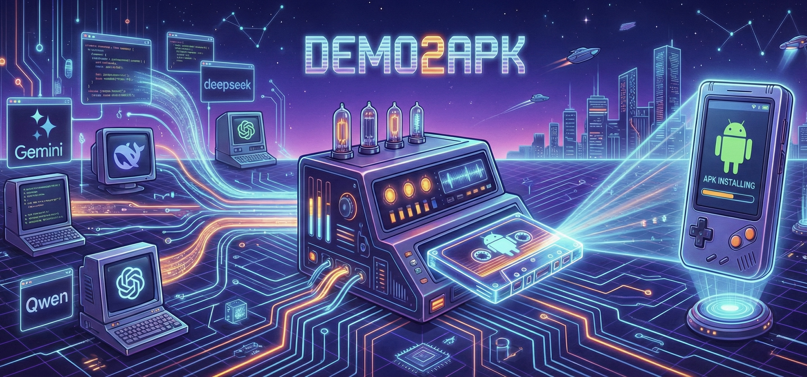

> **这是 Windows 本地化分支。** 上游是 [DeadWaveWave/demo2apk](https://github.com/DeadWaveWave/demo2apk)（MIT）。
> 本分支去掉 Docker、改为本机直接运行，改动见 [docs/WINDOWS.md](docs/WINDOWS.md) 与
> [docs/ERROR_FIXES.md](docs/ERROR_FIXES.md)。英文说明见 [README.md](README.md)。
> 下文的 Docker 部署部分仍保留作参考，但不适用于本分支。



# Demo2APK 🚀


**将你的 Vibe Coding 创意瞬间转化为可运行的 Android App。**

Demo2APK 是专为 Vibe Coding 用户打造的一键打包工具。无论你是从 Gemini、ChatGPT、DeepSeek 等 AI 平台生成了一个绝妙的 Demo，还是完成了一个复杂的前端项目，只需上传文件，我们就能立刻为你生成可安装的 APK。无需配置复杂的 Android 开发环境，让你的创意触手可及。

> 不要随意接受别人的 APK 文件，这可能存在安全风险！

## 🌐 免费公益站点

我们部署了一个**公益站点**，免费提供给大家使用：

👉 **[https://demo2apk.lasuo.ai](https://demo2apk.lasuo.ai)**

- 每个 IP 每小时 5 次构建限制
- 无需注册，开箱即用
- 功能完整，与自部署版本一致

希望能帮到大家！如果觉得有用，请给个 ⭐ Star 支持一下！

---

## ✨ 核心特性

*   **🎨 Web 界面支持**：沉浸式体验构建过程，支持**暗黑工程蓝图风格**。
*   **✏️ 个性化定制**：支持设置**自定义应用名称**、**版本号**和上传**应用图标**。
*   **🔐 Android 权限配置**：通过 UI 自定义 Android 权限 - 精确选择应用所需权限（默认仅包含网络访问）。
*   **📱 PWA 支持**：可选择同时生成可安装的**渐进式 Web 应用**，方便网页部署。
*   **📋 构建历史记录**：自动保存最近构建记录，支持刷新页面后**自动恢复**构建状态。
*   **🧠 智能识别引擎**：自动检测文件类型（HTML/React/ZIP）并匹配最佳构建策略，无需人工干预。
*   **⏳ 智能排队系统**：支持多任务并发控制与排队等待，实时显示队列位置。
*   **🔗 便捷分享**：构建完成后自动生成可分享的下载链接。
*   **⚡️ 极速构建**：优化后的云端流水线，分分钟交付 APK。
*   **🌐 灵活构建模式**：
    *   **单文件模式**：支持上传 `.html`, `.js`, `.jsx`, `.ts`, `.tsx`，自动识别 React 组件并包装。
    *   **代码粘贴模式**：直接粘贴代码文本，智能识别 HTML 或 React/JS 代码。
    *   **ZIP 压缩包模式**：智能区分 **React/Vite 项目**（执行 npm 构建）与 **HTML 多文件项目**（直接打包）。
*   **🧠 智能离线**：自动处理 CDN 资源和 JSX 编译，确保 App 在离线环境下流畅运行。
*   **🛡️ 智能限流**：合理的资源分配策略，支持开发模式下关闭限流。
*   **🧹 自动清理**：构建产物保留 2 小时后自动清理，保护隐私并节省空间。

## ⚠️ React 项目：避免白屏问题

> **重要提示**：如果你的 React/Vite 打包的 APK 显示**白屏/空白页面**，你需要添加 legacy 插件以兼容 Android WebView。

```bash
npm install -D @vitejs/plugin-legacy terser
```

```javascript
// vite.config.js
import legacy from '@vitejs/plugin-legacy'

export default defineConfig({
  plugins: [
    react(),
    legacy({ targets: ['chrome >= 52', 'android >= 5'] })
  ],
  base: './'  // APK 必需！
})
```

📖 **[完整指南：React 项目打包要求](docs/REACT_PROJECT_REQUIREMENTS.md)** - 白屏问题的详细排查方案。

## 🚀 快速开始

### 方式一：Docker 部署（Linux 服务器）

使用预构建的 Docker 镜像，3 分钟部署到你的 Linux 服务器。

> ⚠️ Docker 镜像仅支持 **linux/amd64** 架构。

```bash
# 1. 创建部署目录
mkdir -p ~/demo2apk && cd ~/demo2apk

# 2. 下载部署配置
curl -O https://raw.githubusercontent.com/DeadWaveWave/demo2apk/main/docker-compose.deploy.yml

# 3. (可选) 配置环境变量
curl -O https://raw.githubusercontent.com/DeadWaveWave/demo2apk/main/.env.deploy.example
mv .env.deploy.example .env
# 编辑 .env 文件自定义配置（限流、PWA、资源限制等）

# 4. 启动服务
docker compose -f docker-compose.deploy.yml up -d
```

访问 **http://127.0.0.1:5173** 即可使用 Web 界面。

**更新到最新版本：**
```bash
docker compose -f docker-compose.deploy.yml pull && docker compose -f docker-compose.deploy.yml up -d
```

### 方式二：本地开发（Windows / macOS / Linux）

#### 前置要求

| 环境 | 版本要求 |
|------|---------|
| Node.js | >= 20.0.0 |
| pnpm | >= 9.0.0 |
| Java JDK | >= 21 |
| Android SDK | platform-35 + build-tools 35.0.0 |
| Redis | >= 5.0（Windows 推荐 5.x） |
| Cordova CLI | 最新版 |

#### Windows 安装步骤

```bash
# 1. 安装 Node.js 20+ 和 pnpm（如未安装）
#    下载地址：https://nodejs.org/

# 2. 安装 pnpm（必须 9.x；不带版本号会装 10.x）
npm install -g pnpm@9

# 3. 克隆项目
git clone https://github.com/DeadWaveWave/demo2apk.git
cd demo2apk

# 4. 安装项目依赖
pnpm install

# 5. 安装 Cordova CLI
npm install -g cordova

# 6. 下载 JDK 21（推荐从 https://adoptium.net/ 下载）
#    或使用国内镜像：https://mirrors.tuna.tsinghua.edu.cn/Adoptium/21/jdk/x64/windows/

# 7. 配置 Java 环境变量
#    设置 JAVA_HOME 为 JDK 安装目录，并将 %JAVA_HOME%\bin 加入 PATH

# 8. 安装 Android SDK
#    - 下载 command-line tools：https://developer.android.com/studio#command-line-tools-only
#    - 解压到 C:\Users\<用户名>\Android\Sdk\cmdline-tools\latest\
#    - 安装必要组件：
#      sdkmanager "platform-tools" "platforms;android-35" "build-tools;35.0.0"
#    - 设置 ANDROID_HOME=C:\Users\<用户名>\Android\Sdk

# 9. 启动 Redis（从 https://github.com/tporadowski/redis/releases 下载）
redis-server.exe &

# 10. 构建项目
pnpm build

# 11. 启动所有服务（在三个不同终端中运行）
pnpm frontend        # Web 界面 (端口 5173)
pnpm dev             # API Server (端口 3000)
pnpm worker          # 构建 Worker
```

> ⚠️ Windows 上还差一步：把 Gradle 8.14 解压到
> `%USERPROFILE%\.gradle\gradle-dist\gradle-8.14\`。
> 构建 APK 时直接调用这个固定路径，不会自动下载；缺了它，最后一步报
> `spawn ...\gradle.bat ENOENT`。完整步骤见
> [WINDOWS_LOCAL_SETUP.md §二.6](WINDOWS_LOCAL_SETUP.md)。

访问 **http://localhost:5173** 即可使用 Web 界面。

> **💡 国内用户加速提示：**
> - 设置 npm 镜像：`set NPM_REGISTRY=https://registry.npmmirror.com`
> - Worker 会自动使用该镜像安装依赖

#### macOS / Linux 安装步骤

```bash
# 1. 安装依赖
pnpm install

# 2. 启动 Redis
docker run -d -p 6379:6379 redis:alpine

# 3. 构建项目
pnpm build

# 4. 启动所有服务 (在不同终端中运行)
pnpm dev        # 启动 API Server (端口 3000)
pnpm worker     # 启动构建 Worker
pnpm frontend   # 启动 Web 界面 (端口 5173)
```

访问 **http://localhost:5173** 即可使用 Web 界面。

### 使用 API

如果你更喜欢命令行或脚本集成，可以使用我们的 REST API。

**HTML 单文件打包：**

```bash
curl -X POST http://localhost:3000/api/build/html \
  -F "file=@test-demo.html" \
  -F "appName=TestDemo"
```

**React 项目打包：**

```bash
# 先将项目打包为 ZIP
zip -r test-react-app.zip test-react-app/

# 上传构建（自动识别项目类型）
curl -X POST http://localhost:3000/api/build/zip \
  -F "file=@test-react-app.zip" \
  -F "appName=TestReactApp"
```

**代码粘贴构建：**

```bash
# 上传原始代码 (HTML/JS/React)
curl -X POST http://localhost:3000/api/build/code \
  -F "code=<export default function App() { return <h1>Hello</h1> }" \
  -F "appName=MyReactApp"
```

更多 API 详情请参阅 [API 文档](docs/API.md)。

## ⚙️ 配置说明

### 频率限制 (Rate Limiting)

**默认关闭**：本地打包不做次数限制，想连续打多少次都可以。

需要防止滥用（例如对外开放）时，可以在 `.env` 里显式打开：

```bash
# 打开限流（默认关闭，不设置即不生效）
RATE_LIMIT_ENABLED=true

# 每个时间窗口的请求上限（默认 5）
RATE_LIMIT_MAX=5

# 时间窗口（默认 1 hour）
RATE_LIMIT_WINDOW=1 hour
```

### 文件保留策略

为了节省存储空间并保护用户数据：

*   **保留时间**：构建生成的 APK 和临时文件将在 **2 小时** 后自动删除。
*   **清理机制**：后台 Worker 每 30 分钟执行一次清理扫描（可配置）。

可以通过环境变量修改：

```bash
# 文件保留时间 (小时)
FILE_RETENTION_HOURS=2

# 是否在每次构建后清理 Cordova/Capacitor 临时工程目录
CLEANUP_BUILD_ARTIFACTS=true

# 是否在每次任务结束后清理上传文件（默认 true）
CLEANUP_UPLOADS_ON_COMPLETE=true

# Worker 端是否定期清理过期文件（APK / 构建产物 / 上传文件）
FILE_CLEANUP_ENABLED=true
FILE_CLEANUP_INTERVAL_MINUTES=30
```

### npm 国内镜像

在国内网络环境下，npm 安装依赖可能较慢，可通过 `NPM_REGISTRY` 环境变量指定镜像源：

```bash
# Windows (cmd)
set NPM_REGISTRY=https://registry.npmmirror.com

# 或直接启动 worker 时设置
pnpm worker
```

### 并发与排队 (Concurrency)

控制同时进行的构建任务数量，多余的任务将自动进入队列等待。

```bash
# 并发构建数量 (默认 2)
WORKER_CONCURRENCY=2
```

## 📝 更新日志

查看 [CHANGELOG.md](CHANGELOG.md) 了解版本更新历史。

## 📚 文档与资源

- **[API 文档](docs/API.md)** - 完整的 REST API 接口说明
- **[部署指南](DEPLOYMENT.md)** - 生产环境部署与配置详解
- **[Windows 本地部署](WINDOWS_LOCAL_SETUP.md)** - 环境依赖、Gradle / pnpm 注意事项、常见问题
- **[React 项目指南](docs/REACT_PROJECT_REQUIREMENTS.md)** - 避免白屏问题的最佳实践
- **[PWA 发布指南](docs/PWA_PUBLISHING.md)** - 独立子域发布与安全建议

## 🛠️ 技术栈

*   **Frontend**: React, Vite, Tailwind CSS (Blueprint Style)
*   **Backend**: Node.js, Fastify, TypeScript
*   **Queue**: BullMQ, Redis
*   **Build**: Cordova, Capacitor, Gradle
*   **Deploy**: Docker, Docker Compose

## 📈 社区成长

[](https://star-history.com/#DeadWaveWave/demo2apk&Date)

---

**Made with ❤️ for Vibe Coding**
